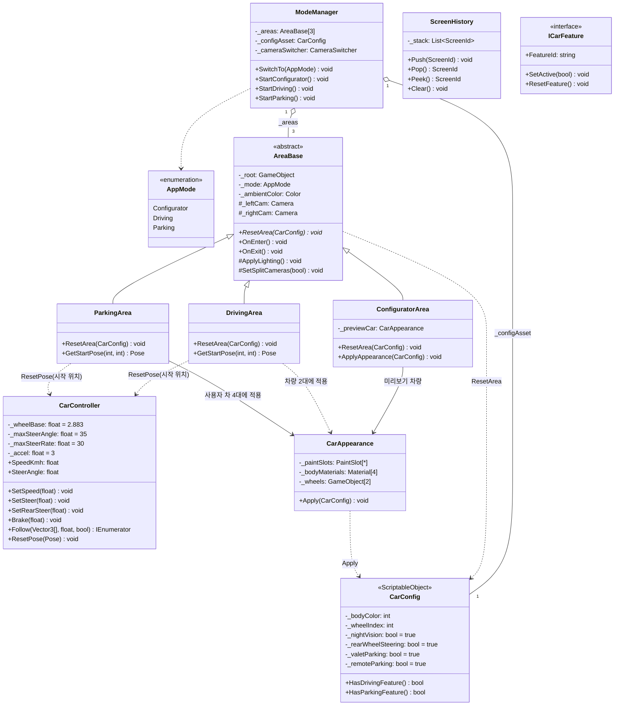
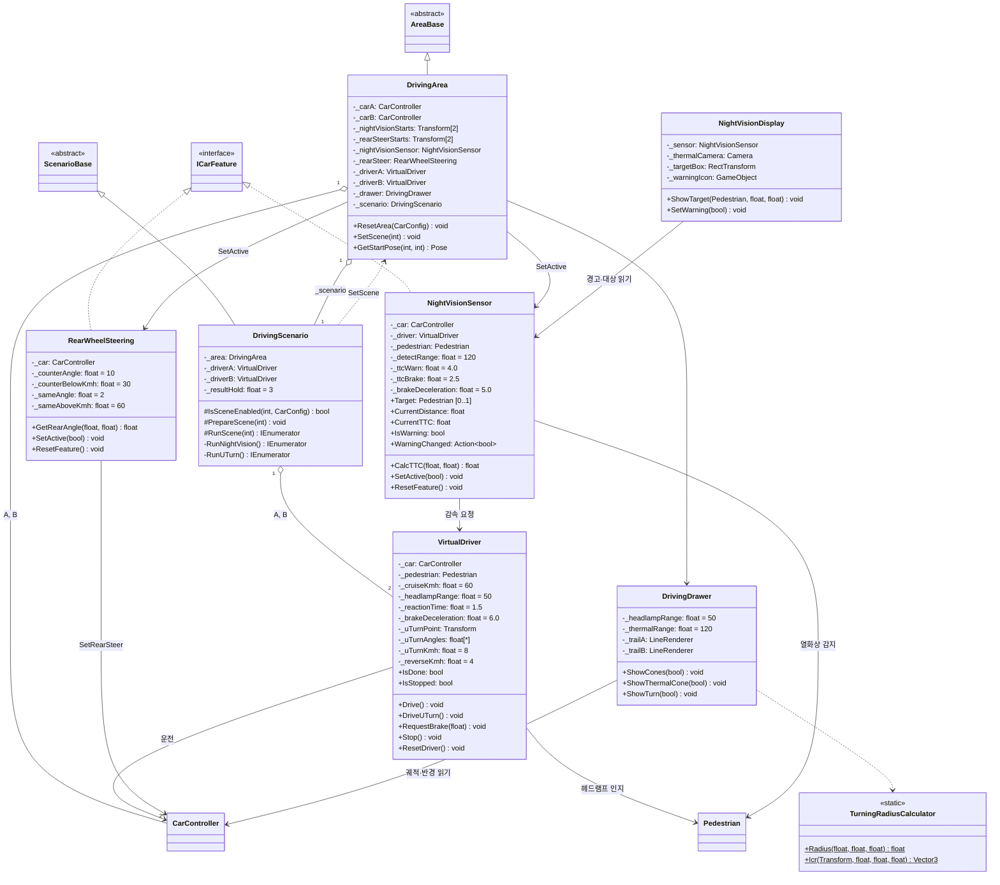
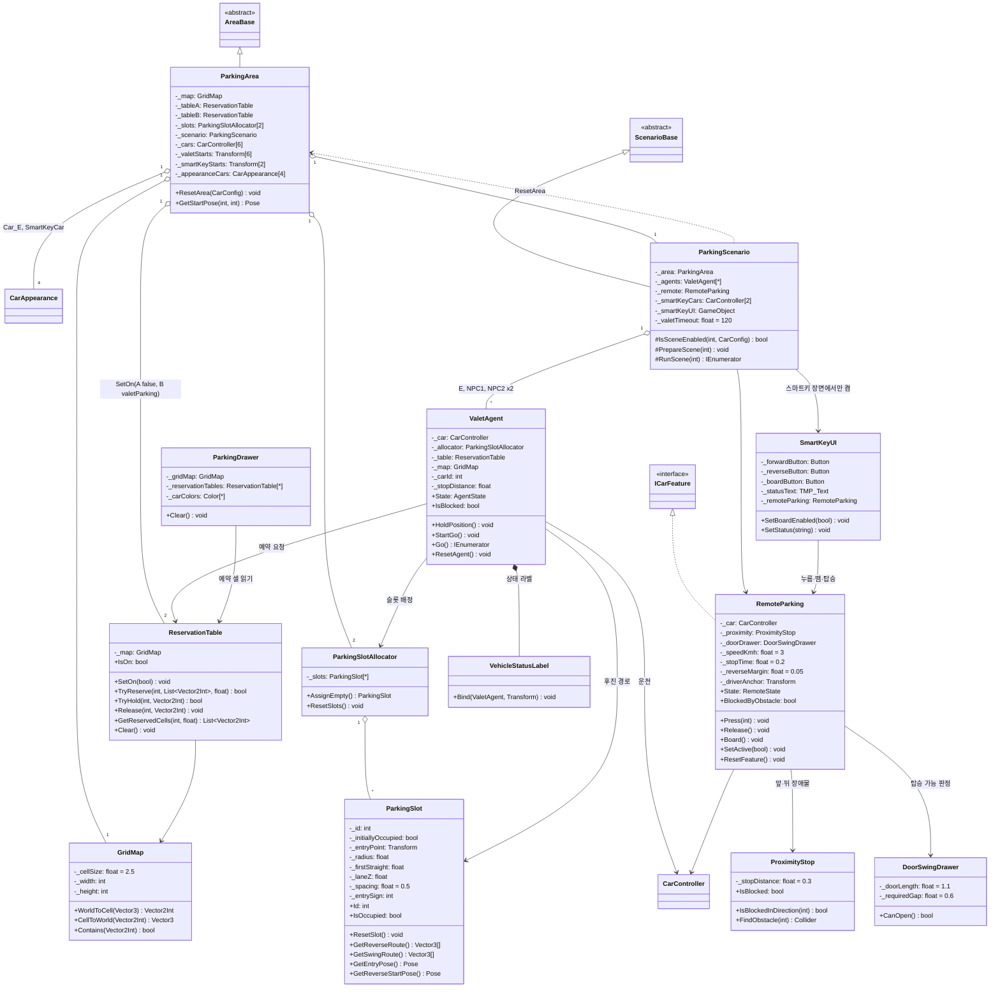

# 클래스 설계서

> 팀 YEYU · 작성 김예은 · 2026.10.07 · 기준: SRS v1.0, `FOLDER_STRUCTURE.md` 5장 · 클래스 다이어그램 1·2차 피드백과 구현 결과 반영본 (2026.10.13)
> 파일 하나 = 클래스 하나. 이름은 `CONVENTIONS.md`(private 필드 `_camelCase`, 네임스페이스는 쓰지 않음)를 따른다.

## 1차 피드백 반영

| 번호 | 피드백 | 반영 |
| --- | --- | --- |
| 0 | FeaturePanel의 ScriptableObject 과함 | `FeatureDescriptions` 삭제. `FeaturePanel._descriptionTexts: TMP_Text[4]`에 Inspector로 입력 |
| 1 | 오른쪽 차량 운전자 없음 | 두 차량 모두 `VirtualDriver`가 운전. 오른쪽만 기능 컴포넌트 ON, 센서는 `RequestBrake()`로 운전자에게 감속 요청 |
| 2 | 조명 전환 책임 없음 | `AreaBase.ApplyLighting()` 추가, `OnEnter()`에서 영역별 ambient 적용 |
| 3 | 측정 책임 없음 | 측정·결과 기록 자체를 범위에서 제외: `ScenarioResult`, `ResultPanel` 삭제 (SRS v0.7 FR-13·UI-05 삭제) |
| 4 | 차량 원위치 불가 | `CarController.ResetPose(Pose)` 추가 (위치·속도·조향각 초기화) |
| 5 | ValetAgent가 ICarFeature 구현 | `ValetAgent`는 일반 클래스로 변경 (예약 테이블 처리 방식은 2차 피드백 1번에서 다시 수정) |
| 6 | IPathProvider + Waypoint + AStar | 셋 다 삭제, 웨이포인트는 `ValetAgent._route`로 흡수 (SRS FR-46·NFR-10 삭제) |
| 7 | IVehicleDriver + BicycleModelDriver 중복 | 둘 다 삭제, 구동은 `CarController` 하나(자전거 모델)로 통일 (SRS FR-43 수정, NFR-11 삭제) |
| 8 | ReverseParkingPlanner + PurePursuitController | 둘 다 삭제, 후진은 미리 찍은 `_reverseRoute` 웨이포인트 추종 (SRS FR-40·41 수정, FR-45 삭제) |
| 9 | Drawer 6개 + DebugDraw | `DrivingDrawer`, `ParkingDrawer`로 통합, `DoorSwingDrawer`만 유지, `DebugDraw` 삭제 |
| 10 | AreaBase, ScenarioBase, ICarFeature 좋음 | 유지 |

결과: 클래스 54개 → 41개.

## 2차 피드백 반영

| 번호 | 피드백 | 반영 |
| --- | --- | --- |
| 1 | `ReservationTable`이 `ICarFeature`를 구현하지만 주차장에 있어 `CarFeatureSwitch`가 찾을 수 없음 | `ICarFeature` 구현 제거. `ParkingArea.ResetArea(config)`가 `SetOn(valetParking)`으로 직접 켜고 끔. `ICarFeature` 구현은 차량에 붙는 3종(NightVisionSensor, RearWheelSteering, RemoteParking)만 남음 |
| 2 | `ResetPose(Pose)`의 시작 위치를 누가 저장하는지 없음 | `DrivingArea`·`ParkingArea`에 장면별·차량별 시작 위치 `_startPoses`와 `GetStartPose(장면, 차량)` 추가. `CarController`는 위치를 저장하지 않고 받은 Pose로만 복귀 |
- 2차 클래스다이어그램 피드백
    
    1.ReservationTable이 ICarFeature 구현 (필수수정) → 기능을 켜고 끄는 CarFeatureSwitch는 Car.prefab에 붙은 기능만 찾습니다. 그런데 ReservationTable은 차가 아니라 ParkingArea에 있어서 CarFeatureSwitch가 찾을 수 없습니다. ICarFeature를 빼고 ParkingArea.ResetArea(config)에서 valetParking 값으로 직접 켜고 끄는 게 더 단순함!
    
    2.ResetPose(Pose) → 시작 위치 Pose를 누가 저장하는지 정해야 함. DrivingArea와 ParkingArea가 차량별 시작 위치를 들고 있으면 될듯.
    
- 개발 과정 중 추가
    
    - 3차 반영: `CameraAnchors` 추가. 이유: `Bind(Camera, Camera)`만으로는 운전석·버드뷰·고정 시점의 목적지를 알 수 없어 카메라별로 앵커 3개를 보관하는 컴포넌트가 필요함 (클래스 41 → 42)
    
    - 4차 반영: `ParkingArea`의 `_startPoses`를 `_valetStarts`(6)·`_smartKeyStarts`(2)로 분리하고 `_cars`(6) 추가. 이유: 장면별 시작 위치를 인덱스 계산 없이 읽기 쉽게 하고, `ResetArea`가 차량 6대를 알아야 하기 때문
    
    - 5차 반영: ParkingSlot 추가. 이유: Allocator가 보관하는 주차면의 데이터(진입 준비 지점, 후진 웨이포인트, 점유 상태)를 담을 타입이 없었음 (클래스 43개)
    
    - 6차 반영: `ValetAgent`에 `StartGo()`·`_allocator`·`_assignedSlot` 추가, `_reverseRoute` 삭제. `ParkingSlot`에 `GetEntryPose()` 추가, 후진 경로를 런타임 계산(`GetReverseRoute()`)으로 변경. 이유: 후진 점을 Transform으로 미리 놓지 않고 형상 파라미터로 계산하는 방식이 튜닝에 빨랐음
    
    - 7차 반영: 트림 제외. `CarConfig._trimIndex`, `CarAppearance._trims`, `ExteriorPanel.OnTrimClicked()` 삭제. 이유: 외관 옵션을 색상과 휠로 한정 (SRS v0.9, FR-02·FR-07 삭제)
    
    - 8차 반영: 구현 결과에 맞춰 도면 전체를 다시 그림 (SRS v1.0). ① 구현하지 않기로 한 클래스 삭제: `CarFeatureSwitch`, `ScenarioTrigger`, `ShowroomCamera`, `ScenarioHUD`, `OptionCardPanel`, `Units`. ② 추가: `VehicleStatusLabel`. ③ 영역 씬 Additive 로드와 `CarConfig` 복사본을 없애고 실제 멤버 이름으로 수정(`UIManager.ShowExterior()` 등, `CameraSwitcher.Switch()`). ④ 주행: 유턴을 막다른 골목의 웨이포인트 대신 같은 2차로 도로 위에서 돈 각도를 누적하는 구간 방식으로 변경(반경이 다른 두 차를 같은 코드로 몰 수 있음), 시점 표시는 `ScenarioHUD` 대신 `UIManager`에 포함(파일을 늘리지 않음), `Pedestrian`은 서 있는 표식. ⑤ 주차: 스마트키 화면, 후진 한계, 외관 적용 대상 추가 (클래스 38개)
    

## 표기법

| 표기 | 의미 |
| --- | --- |
| `+` `-` `#` | public, private, protected |
| 밑줄 (Mermaid `$`) | static |
| 기울임 (Mermaid `*`) | 추상 메서드 |
| `«interface»` `«abstract»` `«enumeration»` `«ScriptableObject»` `«static»` | 스테레오 타입 |
| `[*]` `[0..1]` `[2]` | 다중성: 개수 미정 / 0개 또는 1개 / 고정 개수 |
| `<\|--` / `<\|..` | 상속 / 실체화(인터페이스 구현) |
| `o--` / `*--` | 집합(참조만, 씬에 따로 존재) / 합성(같은 오브젝트의 일부) |
| `-->` / `..>` | 연관(필드로 보유) / 의존(인자로 받거나 잠깐 호출) |

도면에는 클래스마다 핵심 필드와 공개 메서드만 적는다. 색·크기 같은 Inspector 조정값과 내부 도우미 메서드는 뺐다. 네임스페이스는 쓰지 않는다(모든 클래스가 전역).

## 도면 1. 뼈대 — Core · Vehicle (공통)

- `ModeManager`는 `SwitchTo(AppMode)`로 `AreaBase` 3개만 다룬다. 영역은 MainScene에 미리 배치된 프리팹이며, 씬을 새로 로드하지 않는다. 대상 영역의 `ResetArea(config)` → `OnEnter()` 순서로 부른다.
- `AreaBase.OnEnter()`가 영역별 조명(`ApplyLighting()`: `RenderSettings.ambientLight`)과 분할 카메라 2대(`SetSplitCameras(true)`)를 켠다(FR-11, FR-38).
- `CarController`가 모든 차량의 유일한 구동부다. 자전거 모델로 위치·방향을 갱신하고(FR-43, 뒷바퀴 조향 포함), `Follow()`로 웨이포인트를 따라간다(FR-41). 지면 높이와 기울기도 따라간다.
- 시작 위치는 차가 아니라 영역이 보관한다: `DrivingArea`·`ParkingArea`가 장면별·차량별 시작 위치를 들고 있다가 `GetStartPose(장면, 차량)`으로 꺼내 `CarController.ResetPose(Pose)`에 넘긴다(FR-39).
- `CarConfig`는 에셋 하나를 그대로 읽고 쓴다(복사본을 만들지 않는다). 기능 값 4개의 초기값은 모두 true(FR-05). ScriptableObject는 이 하나뿐이다.
- 외관은 영역의 `ResetArea`가 적용한다. `CarAppearance.Apply`를 부른 차만 바뀌므로, 주차의 NPC 차는 기본 외관으로 남는다(FR-10).
- 차량 기능을 켜고 끄는 `CarFeatureSwitch`는 두지 않았다. 기능 컴포넌트의 `SetActive`를 영역과 시나리오가 직접 부른다(맨 아래 표).
- `ScreenHistory`는 뒤로가기·홈의 화면 이동 기록이다(FR-53·54). `ScreenId`(Exterior, Feature, DrivingScene, ParkingScene)는 같은 파일의 중첩 enum이다.

## 도면 2. 공용 — Scenario · Camera · UI (공통)

```mermaid
classDiagram
  direction TB
  class ScenarioBase {
    <<abstract>>
    #_currentIndex: int
    #_config: CarConfig
    -_fadeTime: float = 0.5
    +IsRunning: bool
    +CurrentIndex: int
    +StartFirstScene(CarConfig) void
    +RestartCurrentScene(CarConfig) void
    +GoToNextScene() void
    +StopScenario() void
    #IsSceneEnabled(int, CarConfig)* bool
    #PrepareScene(int) void
    #RunScene(int)* IEnumerator
    #OnStopped() void
  }
  class CameraSwitcher {
    -_left: Camera
    -_right: Camera
    -_leftAnchors: CameraAnchors
    -_rightAnchors: CameraAnchors
    +CurrentView: CameraView
    +Bind(Camera, Camera) void
    +Switch(CameraView) void
    +SwitchToDriver() void
    +SwitchToBirdView() void
    +SetFixedView(bool) void
    +SetRightDriverView(Transform) void
    -ApplyView(Camera, CameraAnchors, CameraView) void
  }
  class CameraAnchors {
    -_driver: Transform
    -_birdEye: Transform
    -_fixed: Transform
    -_birdEyeCutHeight: float
    +Driver: Transform
    +BirdEye: Transform
    +Fixed: Transform
    +BirdEyeCutHeight: float
  }
  class CameraView {
    <<enumeration>>
    Driver
    BirdEye
    Fixed
  }
  class UIManager {
    -_navigationBar: NavigationBar
    -_exteriorPanel: GameObject
    -_featurePanel: GameObject
    -_sceneButtons: GameObject
    -_cameraSwitcher: CameraSwitcher
    -_rightLabel: TMP_Text
    -_drivingScenario: ScenarioBase
    -_parkingScenario: ScenarioBase
    +ShowExterior() void
    +ShowFeature() void
    +ShowDrivingScene() void
    +ShowParkingScene() void
    -ShowOnly(ScreenId) void
    -UpdateSideLabels() void
  }
  class ExteriorPanel {
    -_config: CarConfig
    -_area: ConfiguratorArea
    -_tabs: Button[2]
    -_colorButtons: Button[4]
    -_wheelButtons: Button[2]
    -_summaryColorText: TMP_Text
    -_summaryWheelText: TMP_Text
    +NextClicked: UnityEvent
    +ShowTab(int) void
    +OnColorClicked(int) void
    +OnWheelClicked(int) void
    +Bind(CarConfig) void
  }
  class FeaturePanel {
    -_config: CarConfig
    -_tabs: Button[2]
    -_toggles: Toggle[4]
    -_descriptionTexts: TMP_Text[4]
    -_startButtons: Button[2]
    +StartDrivingClicked: UnityEvent
    +StartParkingClicked: UnityEvent
    +PreviousClicked: UnityEvent
    +ShowTab(int) void
    +Bind(CarConfig) void
    -RefreshStartButtons() void
  }
  class NavigationBar {
    +OnBackClicked() void
    +OnHomeClicked() void
    +Show() void
    +Hide() void
  }
  ScenarioBase ..> CarConfig
  CameraSwitcher ..> CameraView
  CameraSwitcher ..> CameraAnchors : Bind 때 꺼내 씀
  UIManager o-- ExteriorPanel
  UIManager o-- FeaturePanel
  UIManager o-- NavigationBar
  UIManager --> CameraSwitcher : 시점 탭 강조
  UIManager --> ScenarioBase : 장면 이름 라벨
  ExteriorPanel --> ConfiguratorArea : ApplyAppearance
  NavigationBar ..> UIManager : 뒤로가기·홈
```

- `ScenarioBase`가 장면 순서(FR-57), 꺼진 장면 건너뛰기(FR-62), 장면 사이 0.5초 간격을 맡는다. 자식은 `SceneCount`, `IsSceneEnabled`, `PrepareScene`, `RunScene`, `OnStopped`를 채운다. 구간 트리거(`ScenarioTrigger`)는 쓰지 않는다.
- 분할 화면 역할: 카메라 2대 켜기·끄기는 `AreaBase`, 시점 전환은 `CameraSwitcher`(영역에 들어올 때 `ModeManager`가 `Bind(LeftCam, RightCam)`).
- `SetRightDriverView(Transform)`는 [탑승] 때 오른쪽 카메라만 옮긴다. 앵커를 주면 그 자리(스마트키 차의 운전석)로, 안 주면 `CameraAnchors.Driver`로 간다(FR-65).
- 시점 탭 강조와 좌우 라벨 글자는 `ScenarioHUD`를 따로 두지 않고 `UIManager`에 넣었다. 파일을 늘리지 않기 위함이다.
- `UIManager`는 화면(외관·기능·주행·주차)에 맞는 패널만 켠다. 시나리오 중 옵션 카드(`OptionCardPanel`)는 만들지 않았다.
- `ExteriorPanel`은 버튼을 누를 때마다 `CarConfig`를 바꾸고 `ConfiguratorArea.ApplyAppearance`로 쇼룸 차에 바로 적용한다(FR-01·03·58).
- `FeaturePanel`은 설명 문구 4개를 `TMP_Text` 필드에 Inspector로 직접 입력한다(SRS 부록 A 문구).

## 도면 3. 주행 — Driving (김예은)

- 빈 상자(AreaBase, ScenarioBase, ICarFeature, CarController)는 도면 1·2의 클래스를 다시 표시한 것이다.
- 두 차량 모두 `VirtualDriver`가 같은 방식으로 운전한다. 오른쪽 차량에서만 `NightVisionSensor`·`RearWheelSteering`이 켜지고, 센서는 운전자에게 `RequestBrake(5.0)`를 보낸다. 왼쪽 운전자는 헤드램프 50m 인지 → 1.5초 → 6.0m/s²로만 반응한다.
- `Pedestrian`은 도로 위에 서 있는 표식이다(움직이지 않는다). 감지는 차와 보행자 사이의 거리로 한다.
- 유턴은 막다른 골목이 아니라 나이트 비전 장면과 같은 2차로 도로 위에서 한다. `VirtualDriver`는 웨이포인트를 따라가지 않고, 유턴 지점(`_uTurnPoint`)까지 직진한 뒤 **돈 각도를 누적**해 구간별 목표 각도(`_uTurnAngles`)에 이를 때마다 전진·후진을 바꾼다. 왼쪽은 {90, 115, 180}의 3구간, 오른쪽은 {180}의 1구간이다. 구간 목록만 다르게 주면 회전 반경이 다른 두 차를 같은 코드로 몰 수 있다.
- `DrivingArea`가 장면을 준비할 때(`SetScene`) 차를 시작 위치로 되돌리고, 센서와 후륜 조향을 `CarConfig` 값으로 켜고 끄며, 유턴 장면에서는 조명을 밝힌다.
- 그리는 일은 `DrivingDrawer` 하나가 맡는다(헤드램프·열화상 원뿔, 유턴 궤적, ICR, 최소 반경 원, 반경 글자).
- `NightVisionDisplay`는 운전석 시점에서만 열화상 화면을 보이고, 보행자 노란 박스와 경고 아이콘을 표시한다. 거리·충돌 시간 숫자는 표시하지 않는다(FR-19 삭제).

## 도면 4. 주차 — Parking (강유나)

- `ICarFeature`는 차량에 붙는 `RemoteParking`만 구현한다. 발렛 옵션의 실체인 `ReservationTable`은 차가 아니라 주차장에 있으므로 `ParkingArea.ResetArea()`가 `SetOn(valetParking)`으로 직접 켜고 끈다(주차장 A는 항상 `SetOn(false)`).
- `ValetAgent`는 기능이 아니라 차량을 움직이는 에이전트다. E와 NPC 모두 같은 클래스이고, 전역 웨이포인트와 `ParkingSlot`이 형상 파라미터로 계산한 후진 웨이포인트를 `CarController.Follow()`로 따라간다. 테이블이 OFF면 예약 없이 가다가 앞이 막히면 정지한다(FR-28). 주차를 마친 차는 앞차로 보지 않는다.
- `ParkingScenario`는 장면에 나오지 않는 차를 숨기고, 발렛 장면은 주차장 고정 버드뷰로, 스마트키 장면은 고정 시점으로 시작한다. 스마트키 화면(`SmartKeyUI`가 붙은 Canvas)은 `ParkingArea` 프리팹 안에 있고 스마트키 장면에서만 켠다.
- `RemoteParking`은 가려는 방향이 막히면(`ProximityStop`) 움직이지 않고, 처음 주차된 자리보다 뒤로는 가지 않는다(`_reverseMargin`). 뒤쪽 벽에 콜라이더가 없어도 벽에 닿지 않게 하기 위함이다(FR-33).
- `SmartKeyUI`는 [전진] [후진]을 누르는 동안만 `Press`를 보내고, [탑승] 버튼은 `Boardable` 상태에서만 보인다(FR-64). 탑승하면 버튼을 모두 숨긴다(FR-65).
- 그리는 일: `ParkingDrawer`는 버드뷰 예약 셀(차량 색 타일과 "예약" 표지, FR-29), `DoorSwingDrawer`는 문 열림 반경과 탑승 가능 판정(`CanOpen`), `VehicleStatusLabel`은 차량 위 상태 글자(FR-30)를 맡는다. 후진 웨이포인트는 화면에 그리지 않는다(FR-44 삭제).

## 클래스 도출표

| 폴더 | 클래스 | 수 |
| --- | --- | --- |
| `Core` | ModeManager, AreaBase, AppMode, CarConfig, ConfiguratorArea, ScreenHistory | 6 |
| `Vehicle` | CarController, CarAppearance, ICarFeature | 3 |
| `Camera` | CameraSwitcher (+ CameraView), CameraAnchors | 2 |
| `Scenario` | ScenarioBase | 1 |
| `UI` | UIManager, ExteriorPanel, FeaturePanel, NavigationBar | 4 |
| `Driving` | DrivingArea, DrivingScenario, VirtualDriver, Pedestrian, NightVisionSensor, NightVisionDisplay, RearWheelSteering, TurningRadiusCalculator, DrivingDrawer | 9 |
| `Parking` | ParkingArea, ParkingScenario, GridMap, ParkingSlot, ParkingSlotAllocator, ReservationTable, ValetAgent, RemoteParking, SmartKeyUI, ProximityStop, ParkingDrawer, DoorSwingDrawer, VehicleStatusLabel | 13 |
| 합계 |  | 38 |

테스트 스크립트(`_CameraSwitcherTester`, `_ParkingAreaTester`)와 에디터 스크립트(`_ExteriorPanelBuilder`, `_FeaturePanelBuilder`, `_NavigationBarBuilder`, `_SmartKeyUIBuilder`, `_SceneViewCameraAligner`)는 표에서 뺐다.

## CarConfig 기능 값과 켜는 곳

| CarConfig 필드 | 구현 클래스 | 붙는 곳 | 켜고 끄는 곳 | 장면 |
| --- | --- | --- | --- | --- |
| nightVision | NightVisionSensor | 오른쪽 차량 | `DrivingArea`가 장면을 준비할 때 `SetActive` | 주행 1 |
| rearWheelSteering | RearWheelSteering | 오른쪽 차량 | `DrivingArea`가 장면을 준비할 때 `SetActive` | 주행 2 |
| valetParking | ReservationTable (ICarFeature 아님) | 주차장 B | `ParkingArea.ResetArea()`가 `SetOn(valetParking)` | 주차 1 |
| remoteParking | RemoteParking | 주차장 B의 스마트키 차 | `ParkingScenario`가 스마트키 장면에서 `SetActive(true)` | 주차 2 |

꺼진 기능의 장면은 `ScenarioBase`가 `IsSceneEnabled`로 건너뛴다(FR-62).
